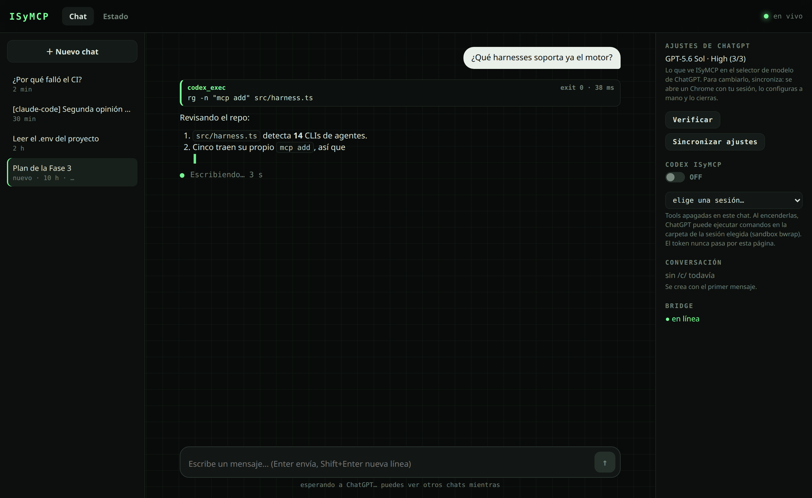

<div align="center">

# ISyMCP

### Tus agentes, tus herramientas y tu computadora. En un solo lugar.

**Un centro de control local para conectar asistentes de IA, herramientas MCP y flujos de trabajo reales, con permisos explícitos y resultados verificables.**

*Local-first control center for AI agents, MCP tools and verifiable workflows.*

[](https://github.com/DannyBaanks/chatgpt-http-mcp/actions/workflows/ci.yml)
[](https://github.com/DannyBaanks/chatgpt-http-mcp/releases)
[](LICENSE)
[](https://bun.sh/)

**[Empezar](#-empieza-en-minutos)** · **[Descargas](https://github.com/DannyBaanks/chatgpt-http-mcp/releases)** · **[Guía completa](GUIA.md)** · **[Documentación técnica](docs/PRODUCT_DEEP_DIVE.md)**


<sub>Captura ilustrativa con datos de demostración.</sub>

</div>

> [!IMPORTANT]
> **Proyecto independiente y experimental.** ISyMCP **no es un producto oficial de OpenAI**. Algunas funciones usan automatización del sitio web de ChatGPT: no son la API oficial, pueden dejar de funcionar y podrían estar sujetas a restricciones de la plataforma. La conexión y ejecución de herramientas requieren autorización. Lee [seguridad y compatibilidad](#-seguridad-y-limitaciones) antes de conectar una cuenta.

## ✨ ¿Qué puedes hacer con ISyMCP?

ISyMCP reúne en una interfaz local las piezas que normalmente viven separadas: el chat, los agentes de código, las herramientas, el estado de los servicios y la evidencia de lo que realmente ocurrió.

| | Capacidad | Para qué te sirve |
|---|---|---|
| 💬 | **Panel de chat y actividad** | Conversaciones, estado de servicios y resultados de herramientas desde una interfaz local. |
| 🧩 | **Herramientas MCP** | Conecta capacidades de desarrollo y utilidades con clientes y agentes compatibles. |
| 🛡️ | **Ejecución con permisos** | Elige el workspace, delimita lectura/escritura y revisa la ejecución real. |
| 🤝 | **Varios agentes, un mismo entorno** | Integra flujos con Codex, Claude Code, Cursor, OpenCode y otras herramientas compatibles. |
| 🎬 | **Multimedia local** | Inspecciona video y audio registrados: fotogramas, espectrogramas y mediciones. |
| ⚡ | **Cómputo remoto y Hive headless** | Despacha procesos asíncronos CPU/GPU/WSL2 a otra máquina emparejada (cifrado E2E, sin Electron) y coordina agentes en disco. |
| 📊 | **Diagnóstico y observabilidad** | Salud, métricas, canarios y pruebas para detectar fallos en el puente. |

<details>
<summary>¿Qué significa «resultados verificables»?</summary>

Los recibos muestran eventos de ejecución observados, como la herramienta invocada, el código de salida y la duración cuando están disponibles. **No** son una garantía de que toda operación futura funcionará ni una reconstrucción de datos que no se registraron. [Ver evidencia y límites](docs/EVIDENCE.md).

</details>

## ChatGPT GPT-6.2

`isymcp ask "texto" --new` y la herramienta MCP `chatgpt_ask` ahora usan
**GPT-6.2 / High**. El bridge selecciona el modelo exacto y verifica la potencia
antes de enviar; el chat local y el canario recorren la misma comprobación.
Si el modelo no está disponible, devuelve un error sin cambiar a otra versión.

Para clientes compatibles con OpenAI, la ruta es `chatgpt-web/gpt-6.2`, habilitada
con `CODEX_WEB_HTTP_CAPS=gpt62`. El presupuesto del adaptador es conservador;
no representa una medición del contexto máximo del modelo. Las rutas anteriores
siguen disponibles mediante sus capacidades explícitas.

La sesión de ChatGPT debe estar activa. Una sesión cerrada se informa como
`web_session_expired`; `chatgpt_ask` conserva el detalle del error para facilitar
el diagnóstico. [Renovar la sesión y usar Ask](GUIA.md#ask-y-gpt-62).

## 🖥️ Un panel para ver qué está pasando

El panel local reúne **Conversación**, **Evidencia** y **Actividad**. Puedes comprobar las herramientas de una sesión, identificar fallos y consultar el estado del puente sin saltar entre terminales.



También incluye utilidades de diagnóstico y controles de servicio; las operaciones privilegiadas deben atravesar las verificaciones de autorización del backend. [Conoce las funciones en detalle](docs/PRODUCT_DEEP_DIVE.md#what-you-get).

## 🚀 Empieza en minutos

**Necesitas:** [Bun](https://bun.sh/) y un equipo Linux o Windows. Para funciones particulares pueden requerirse Chrome/Edge, FFmpeg, un sandbox y una integración configurada.

```bash
git clone https://github.com/DannyBaanks/chatgpt-http-mcp.git
cd chatgpt-http-mcp
bun install --frozen-lockfile
bun link

# Comprueba el entorno antes de activar integraciones
isymcp doctor

# Abre el panel local
isymcp panel
```

El panel funciona en **http://127.0.0.1:8798**. Para utilizar chat, túneles o agentes con servicios externos necesitas configurar sus credenciales y permisos; abrir el panel **no** implica que la conexión remota esté lista.

**Sigue con:** [Guía paso a paso en español](GUIA.md) · [Instalación en Windows](docs/WINDOWS.md) · [Descargar una versión publicada](https://github.com/DannyBaanks/chatgpt-http-mcp/releases).

### Conectar el hub a cualquier cliente MCP (npx / npm)

El hub expone **todos** los MCP que administra a través de una sola conexión: cuatro herramientas
(`hub_discover`, `hub_describe`, `hub_execute`, `agentspipeline`) en lugar de registrar cada MCP por
separado. El conector está publicado en npm y no necesita instalar Bun ni el repositorio:

```bash
npx -y isymcp-hub-mcp --doctor   # ¿hay socket, binario y hub? (texto)
npx -y isymcp-hub-mcp --status   # lo mismo en JSON
```

Para conectarlo, registra un MCP **stdio** en tu cliente (AutoClaw, Claude Code, Codex, Cursor,
OpenCode, o cualquier cliente compatible):

| Campo | Valor |
|---|---|
| Nombre | `isymcp-hub` |
| Comando | `npx` |
| Argumentos | `-y isymcp-hub-mcp` |

O instálalo una vez si prefieres no depender de la red en cada arranque:

```bash
npm install -g isymcp-hub-mcp        # deja `isymcp-hub-mcp` en el PATH
# y en el cliente: comando `isymcp-hub-mcp`, sin argumentos
```

**Requisito:** el daemon del hub tiene que existir (`isymcp hub install --enable`, o `cd hub && zig build -Doptimize=ReleaseSafe` con Zig 0.16). Si no lo encuentra, el conector **falla con instrucciones** y no crea un hub paralelo.

> [!IMPORTANT]
> El conector **no** implementa herramientas ni relaja permisos: transporta bytes hacia el socket
> del hub, y las tools siguen siendo del daemon con su aislamiento y autorizaciones. Cada servidor
> conserva sus propias credenciales.

Flujo típico desde un agente:

1. `hub_discover` — lista los MCP y su estado (con `server`, su catálogo; con `query`, búsqueda).
2. `hub_describe(server, tool)` — esquema de entrada antes de llamar.
3. `hub_execute(server, tool, arguments)` — ejecuta con las reglas del hub.
4. `agentspipeline` — orquestación multi-agente en worktrees; integrar cambios sigue exigiendo
   autorización explícita (`integration_authorized`).

Código del paquete y tests: [`packages/isymcp-hub-mcp`](packages/isymcp-hub-mcp).

> [!TIP]
> Ejecuta `isymcp` sin argumentos para explorar el menú. Usa `isymcp dash` (o `isymcp status`) para revisar servicios e `isymcp smoke` para ejecutar comprobaciones locales.

## 🖥️ Panel en la terminal: `isymcp dash`

`isymcp dash` abre el panel de administración dentro de la terminal, sin navegador. Muestra en una sola pantalla:

- **Servicios:** server (`:8791`), túnel, panel (`:8798`), monitor (`:8799`), proceso MCP, último canario y tareas.
- **Permisos:** `shell` y `agents` (abiertos o cerrados y hasta cuándo) y el estado de *taint*.
- **Sesiones** de ChatGPT, vivas y caducadas.
- **Hub:** cada MCP que sirve `isymcp-hub`, con su estado, herramientas e instancias.

Desde el panel se maneja todo con una tecla: `u`/`d` subir o bajar server y túnel, `t`/`T` túnel, `p`/`P` panel, `m`/`M` monitor, `c` canario, `D` doctor, `s`/`a` permitir shell o agents una vez, `S`/`A` cerrarlos, `x` limpiar taint, `r` recargar el hub, `R` reiniciarlo, `l` log, `?` ayuda y `q` salir. Las acciones que paran servicios, abren permisos o reinician el hub (`d`, `r`, `s`, `a`, `x`, `R`) piden confirmar con `y`; `r` y `R` reinician los MCP de **todas** las TUIs conectadas al hub.

`isymcp status --json` da el mismo estado como un objeto JSON (`isymcp-status/1`): un campo que no se puede leer sale en `null` en vez de fallar. Es lo que usan el panel y otras herramientas. Las pestañas `🔌 ISyMCP` de `claude-dash` y de `agy-dash` (`Alt+I`) abren este mismo panel.

## ⚡ Cómputo remoto asíncrono, Link E2E y Hive headless

ISyMCP incluye un carril ligero **sin Electron** para coordinar agentes en disco (**Hive**), enlazar máquinas por LAN o Tailscale (**Link**, protocolo `munder-link@1` con Ed25519 + X25519 + AES-256-GCM) y enviar procesos asíncronos de CPU o GPU a un equipo remoto (por ejemplo, de una laptop Linux a una estación Windows/WSL2 con GPU NVIDIA):

- **Fail-closed por defecto:** emparejar con SAS de 6 dígitos solo concede autoridad `office`. Ejecutar procesos remotos (`compute`) permanece bloqueado hasta que el operador lo habilita explícitamente en la máquina destino (`isymcp link compute allow <peer>`).
- **Aislamiento y seguridad:** los jobs remotos arrancan con un entorno mínimo de allowlist (nunca heredan tokens ni secretos del servidor), quedan aislados por peer, tienen tope de tiempo y tamaño de log, limpian procesos huérfanos al reiniciar y pasan por las puertas `host_shell` / `agent_spawn` + *taint* en MCP.
- **Multiplataforma:** soporta `target: "posix"`, `target: "win"` (nativo Windows con clases de prioridad y tree-kill) y `target: "wsl"` (WSL2 + CUDA con aislamiento por PGID), además de telemetría `nvidia-smi` y descarga de artefactos por bloques con SHA-256.
- **Herramienta MCP directa (`isymcp-compute`):** el servidor stdio `src/mcp/compute.ts` expone `compute_peers`, `compute_telemetry`, `compute_run` (con `wait_ms` opcional), `compute_status`, `compute_list`, `compute_cancel`, `compute_fetch`, `hive_status`, `hive_send` y `link_delegate` para registrarlo en `isymcp-hub`, además de las acciones `compute.*`, `link.*` y `hive.*` en el Universal Gateway.

```bash
# En la máquina worker (Windows o Linux; en Windows existe scripts/windows/install-link-worker.ps1)
isymcp link serve --port 47831

# En la máquina cliente: emparejar con código SAS de 6 dígitos
isymcp link pair <ip-lan-o-tailscale>:47831 --accept
# En el worker: aceptar el SAS y habilitar cómputo explícitamente
isymcp link accept <codigo-6-digitos>
isymcp link compute allow <office_id>

# Consultar GPU/slots y despachar un job asíncrono (Windows nativo, WSL2/CUDA o POSIX)
isymcp compute telemetry <peer>
isymcp compute run <peer> --target wsl --gpu -- nvidia-smi
```

## 🔗 Tu flujo, tus herramientas

<details>
<summary><b>Trabajar con Codex sin reemplazar su configuración global</b></summary>

ISyMCP ofrece perfiles aislados: `codex` sigue funcionando de forma independiente, mientras `isymcp codex` selecciona su perfil específico. Consulta [perfiles, sesiones y ciclo de vida](docs/PRODUCT_DEEP_DIVE.md#isolated--decoupled-codex-profiles).

</details>

<details>
<summary><b>Dar acceso a un proyecto, no a toda la computadora</b></summary>

Las sesiones MCP pueden vincularse a una carpeta y operar en modo de lectura predeterminado. Las capacidades de escritura requieren habilitación explícita y quedan sujetas al backend de autorización y al aislamiento disponible. [Tokens, sandbox y amenazas](docs/PROTOCOL.md) · [Seguridad operativa](docs/PRODUCT_DEEP_DIVE.md#security-model).

</details>

<details>
<summary><b>Analizar video y audio sin subir los originales por defecto</b></summary>

Registra archivos locales o prepara contenido compatible; usa herramientas MCP para obtener fotogramas, hojas de contacto, segmentos de actividad y medidas de señal. **La medición acústica no equivale a transcripción ni reconocimiento de voz.** [Flujos y límites de multimedia](docs/PRODUCT_DEEP_DIVE.md#local-media-mcp).

</details>

<p align="center">
  
</p>

## 📚 Documentación, sin perder lo técnico

| Quiero entender… | Abre… |
|---|---|
| Funciones completas, comandos, API, medios y límites | **[Referencia técnica ampliada](docs/PRODUCT_DEEP_DIVE.md)** |
| Instalación y uso paso a paso | [Guía del operador](GUIA.md) |
| Arquitectura, componentes y fronteras | [Arquitectura](docs/ARCHITECTURE.md) |
| Sesiones, contratos y errores | [Protocolo](docs/PROTOCOL.md) |
| Integración privada con ChatGPT | [Integraciones y HTTP/MCP](docs/PRODUCT_DEEP_DIVE.md#experimental-http-compatibility-endpoint-not-the-official-openai-api) |
| Windows, Docker y sandbox nativo | [Windows](docs/WINDOWS.md) |
| Pruebas, evidencia y alcance real | [Registro de evidencia](docs/EVIDENCE.md) |
| Versiones, cambios y publicación | [Changelog](CHANGELOG.md) · [Releases](https://github.com/DannyBaanks/chatgpt-http-mcp/releases) |

## 🔐 Seguridad y limitaciones

ISyMCP está pensado para funcionar **localmente, con permisos delimitados**, pero no convierte el equipo en un entorno libre de riesgos:

- **No afiliación y compatibilidad:** el adaptador experimental de ChatGPT Web no es una integración oficial ni garantiza permiso de automatización. Para uso programático desatendido, prefiere una API oficialmente soportada.
- **Permisos reales:** no confundas los permisos de una sesión, el aislamiento del sistema ni el acceso que concede un servicio externo. Una herramienta solo debe ejecutar aquello para lo que tiene autorización.
- **Datos sensibles:** protege tokens, cookies y archivos de sesión; evita publicarlos en logs, issues o capturas.
- **Pruebas con alcance:** una prueba verde verifica ese escenario, no todos los entornos. Consulta la [evaluación de compatibilidad y riesgos](docs/compliance/FINAL_VERDICT.md) y la [evidencia registrada](docs/EVIDENCE.md).

Para informar de vulnerabilidades, consulta [SECURITY.md](SECURITY.md).

---

<div align="center">

### Construido para conectar herramientas, sin perder el control.

**[Empezar](GUIA.md)** · **[Explorar lo técnico](docs/PRODUCT_DEEP_DIVE.md)** · **[Ver el código](https://github.com/DannyBaanks/chatgpt-http-mcp)**

MIT · [LICENSE](LICENSE) · [NOTICE](NOTICE)

</div>
