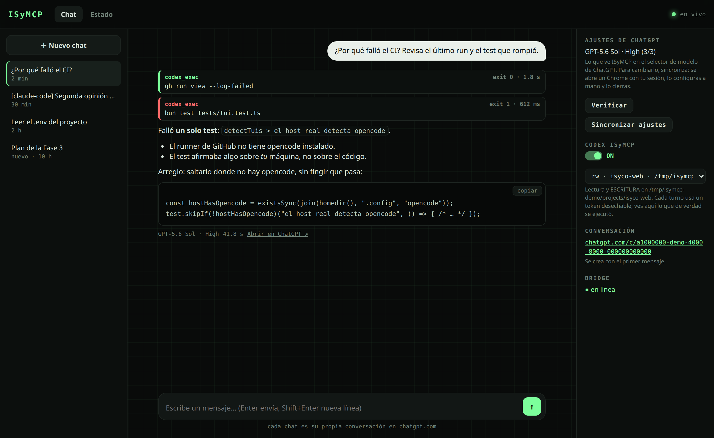
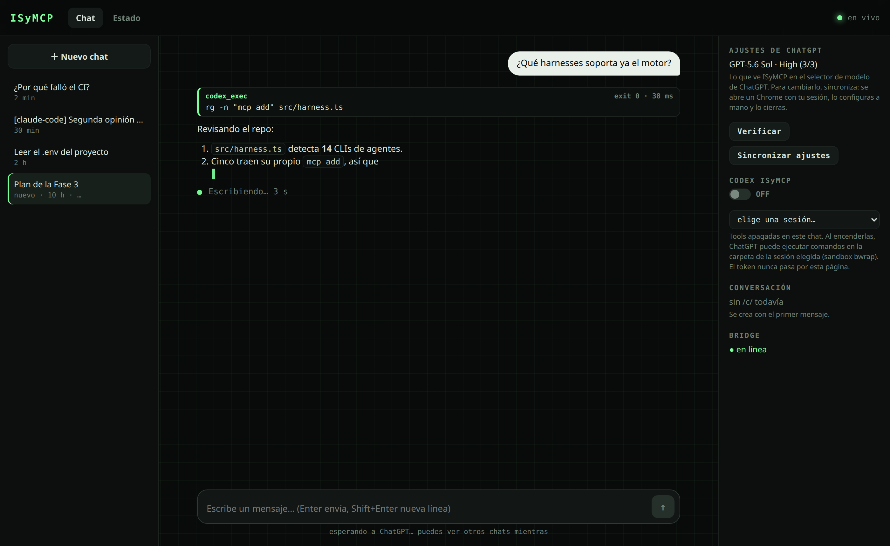
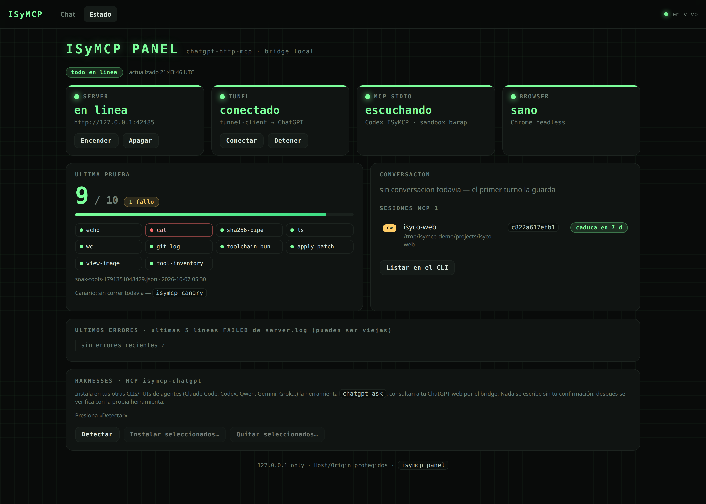

<div align="center">

# ISyMCP

### Tus agentes, tus herramientas y tu computadora. En un solo lugar.

**Un centro de control local para conectar asistentes de IA, herramientas MCP y flujos de trabajo reales, con permisos explícitos y resultados verificables.**

*Local-first control center for AI agents, MCP tools and verifiable workflows.*

[](https://github.com/DannyBaanks/chatgpt-http-mcp/actions/workflows/ci.yml)
[](https://github.com/DannyBaanks/chatgpt-http-mcp/releases)
[](LICENSE)
[](https://bun.sh/)

**[Empezar](#-empieza-en-minutos)** · **[Descargas](https://github.com/DannyBaanks/chatgpt-http-mcp/releases)** · **[Guía completa](GUIA.md)** · **[Documentación técnica](docs/PRODUCT_DEEP_DIVE.md)**



<sub>Captura ilustrativa con datos de demostración.</sub>

</div>

> [!IMPORTANT]
> **Proyecto independiente y experimental.** ISyMCP **no es un producto oficial de OpenAI**. Algunas funciones usan automatización del sitio web de ChatGPT: no son la API oficial, pueden dejar de funcionar y podrían estar sujetas a restricciones de la plataforma. La conexión y ejecución de herramientas requieren autorización. Lee [seguridad y compatibilidad](#-seguridad-y-limitaciones) antes de conectar una cuenta.

## ✨ ¿Qué puedes hacer con ISyMCP?

ISyMCP reúne en una interfaz local las piezas que normalmente viven separadas: el chat, los agentes de código, las herramientas, el estado de los servicios y la evidencia de lo que realmente ocurrió.

| | Capacidad | Para qué te sirve |
|---|---|---|
| 💬 | **Panel de chat y actividad** | Conversaciones, estado de servicios y resultados de herramientas desde una interfaz local. |
| 🧩 | **Herramientas MCP** | Conecta capacidades de desarrollo y utilidades con clientes y agentes compatibles. |
| 🛡️ | **Ejecución con permisos** | Elige el workspace, delimita lectura/escritura y revisa la ejecución real. |
| 🤝 | **Varios agentes, un mismo entorno** | Integra flujos con Codex, Claude Code, Cursor, OpenCode y otras herramientas compatibles. |
| 🎬 | **Multimedia local** | Inspecciona video y audio registrados: fotogramas, espectrogramas y mediciones. |
| 📊 | **Diagnóstico y observabilidad** | Salud, métricas, canarios y pruebas para detectar fallos en el puente. |

<details>
<summary>¿Qué significa «resultados verificables»?</summary>

Los recibos muestran eventos de ejecución observados, como la herramienta invocada, el código de salida y la duración cuando están disponibles. **No** son una garantía de que toda operación futura funcionará ni una reconstrucción de datos que no se registraron. [Ver evidencia y límites](docs/EVIDENCE.md).

</details>

## 🖥️ Un panel para ver qué está pasando

El panel local reúne **Conversación**, **Evidencia** y **Actividad**. Puedes comprobar las herramientas de una sesión, identificar fallos y consultar el estado del puente sin saltar entre terminales.



También incluye utilidades de diagnóstico y controles de servicio; las operaciones privilegiadas deben atravesar las verificaciones de autorización del backend. [Conoce las funciones en detalle](docs/PRODUCT_DEEP_DIVE.md#what-you-get).

## 🚀 Empieza en minutos

**Necesitas:** [Bun](https://bun.sh/) y un equipo Linux o Windows. Para funciones particulares pueden requerirse Chrome/Edge, FFmpeg, un sandbox y una integración configurada.

```bash
git clone https://github.com/DannyBaanks/chatgpt-http-mcp.git
cd chatgpt-http-mcp
bun install --frozen-lockfile
bun link

# Comprueba el entorno antes de activar integraciones
isymcp doctor

# Abre el panel local
isymcp panel
```

El panel funciona en **http://127.0.0.1:8798**. Para utilizar chat, túneles o agentes con servicios externos necesitas configurar sus credenciales y permisos; abrir el panel **no** implica que la conexión remota esté lista.

**Sigue con:** [Guía paso a paso en español](GUIA.md) · [Instalación en Windows](docs/WINDOWS.md) · [Descargar una versión publicada](https://github.com/DannyBaanks/chatgpt-http-mcp/releases).

> [!TIP]
> Ejecuta `isymcp` sin argumentos para explorar el menú. Usa `isymcp status` para revisar servicios e `isymcp smoke` para ejecutar comprobaciones locales.

## 🔗 Tu flujo, tus herramientas

<details>
<summary><b>Trabajar con Codex sin reemplazar su configuración global</b></summary>

ISyMCP ofrece perfiles aislados: `codex` sigue funcionando de forma independiente, mientras `isymcp codex` selecciona su perfil específico. Consulta [perfiles, sesiones y ciclo de vida](docs/PRODUCT_DEEP_DIVE.md#isolated--decoupled-codex-profiles).

</details>

<details>
<summary><b>Dar acceso a un proyecto, no a toda la computadora</b></summary>

Las sesiones MCP pueden vincularse a una carpeta y operar en modo de lectura predeterminado. Las capacidades de escritura requieren habilitación explícita y quedan sujetas al backend de autorización y al aislamiento disponible. [Tokens, sandbox y amenazas](docs/PROTOCOL.md) · [Seguridad operativa](docs/PRODUCT_DEEP_DIVE.md#security-model).

</details>

<details>
<summary><b>Analizar video y audio sin subir los originales por defecto</b></summary>

Registra archivos locales o prepara contenido compatible; usa herramientas MCP para obtener fotogramas, hojas de contacto, segmentos de actividad y medidas de señal. **La medición acústica no equivale a transcripción ni reconocimiento de voz.** [Flujos y límites de multimedia](docs/PRODUCT_DEEP_DIVE.md#local-media-mcp).

</details>

<p align="center">
  
</p>

## 📚 Documentación, sin perder lo técnico

| Quiero entender… | Abre… |
|---|---|
| Funciones completas, comandos, API, medios y límites | **[Referencia técnica ampliada](docs/PRODUCT_DEEP_DIVE.md)** |
| Instalación y uso paso a paso | [Guía del operador](GUIA.md) |
| Arquitectura, componentes y fronteras | [Arquitectura](docs/ARCHITECTURE.md) |
| Sesiones, contratos y errores | [Protocolo](docs/PROTOCOL.md) |
| Integración privada con ChatGPT | [Integraciones y HTTP/MCP](docs/PRODUCT_DEEP_DIVE.md#experimental-http-compatibility-endpoint-not-the-official-openai-api) |
| Windows, Docker y sandbox nativo | [Windows](docs/WINDOWS.md) |
| Pruebas, evidencia y alcance real | [Registro de evidencia](docs/EVIDENCE.md) |
| Versiones, cambios y publicación | [Changelog](CHANGELOG.md) · [Releases](https://github.com/DannyBaanks/chatgpt-http-mcp/releases) |

## 🔐 Seguridad y limitaciones

ISyMCP está pensado para funcionar **localmente, con permisos delimitados**, pero no convierte el equipo en un entorno libre de riesgos:

- **No afiliación y compatibilidad:** el adaptador experimental de ChatGPT Web no es una integración oficial ni garantiza permiso de automatización. Para uso programático desatendido, prefiere una API oficialmente soportada.
- **Permisos reales:** no confundas los permisos de una sesión, el aislamiento del sistema ni el acceso que concede un servicio externo. Una herramienta solo debe ejecutar aquello para lo que tiene autorización.
- **Datos sensibles:** protege tokens, cookies y archivos de sesión; evita publicarlos en logs, issues o capturas.
- **Pruebas con alcance:** una prueba verde verifica ese escenario, no todos los entornos. Consulta la [evaluación de compatibilidad y riesgos](docs/compliance/FINAL_VERDICT.md) y la [evidencia registrada](docs/EVIDENCE.md).

Para informar de vulnerabilidades, consulta [SECURITY.md](SECURITY.md).

---

<div align="center">

### Construido para conectar herramientas, sin perder el control.

**[Empezar](GUIA.md)** · **[Explorar lo técnico](docs/PRODUCT_DEEP_DIVE.md)** · **[Ver el código](https://github.com/DannyBaanks/chatgpt-http-mcp)**

MIT · [LICENSE](LICENSE) · [NOTICE](NOTICE)

</div>
