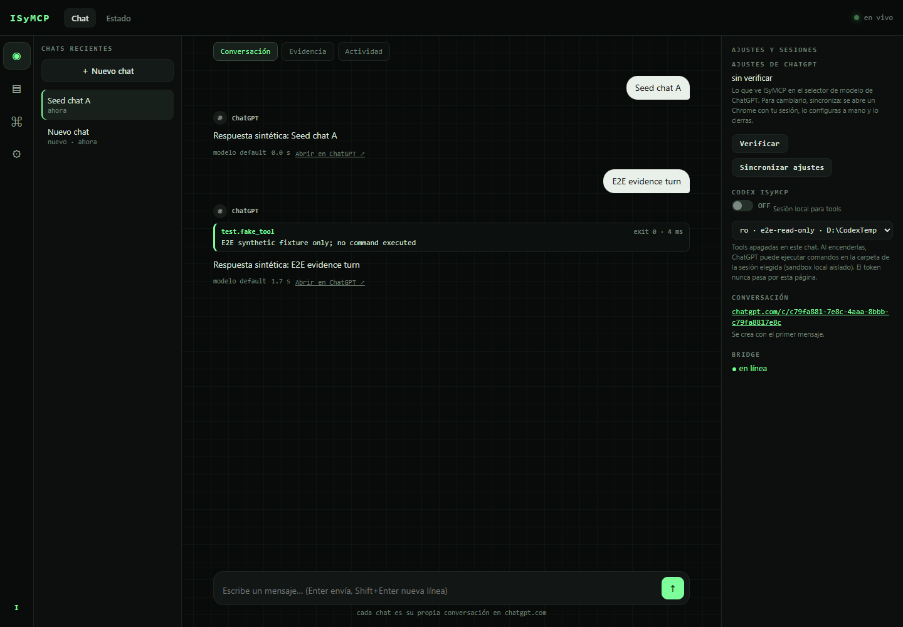
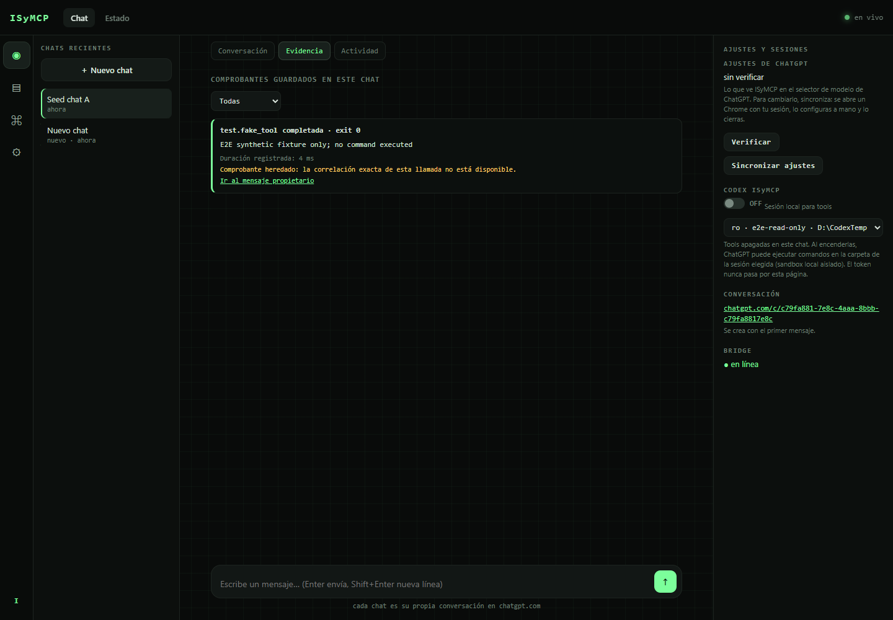
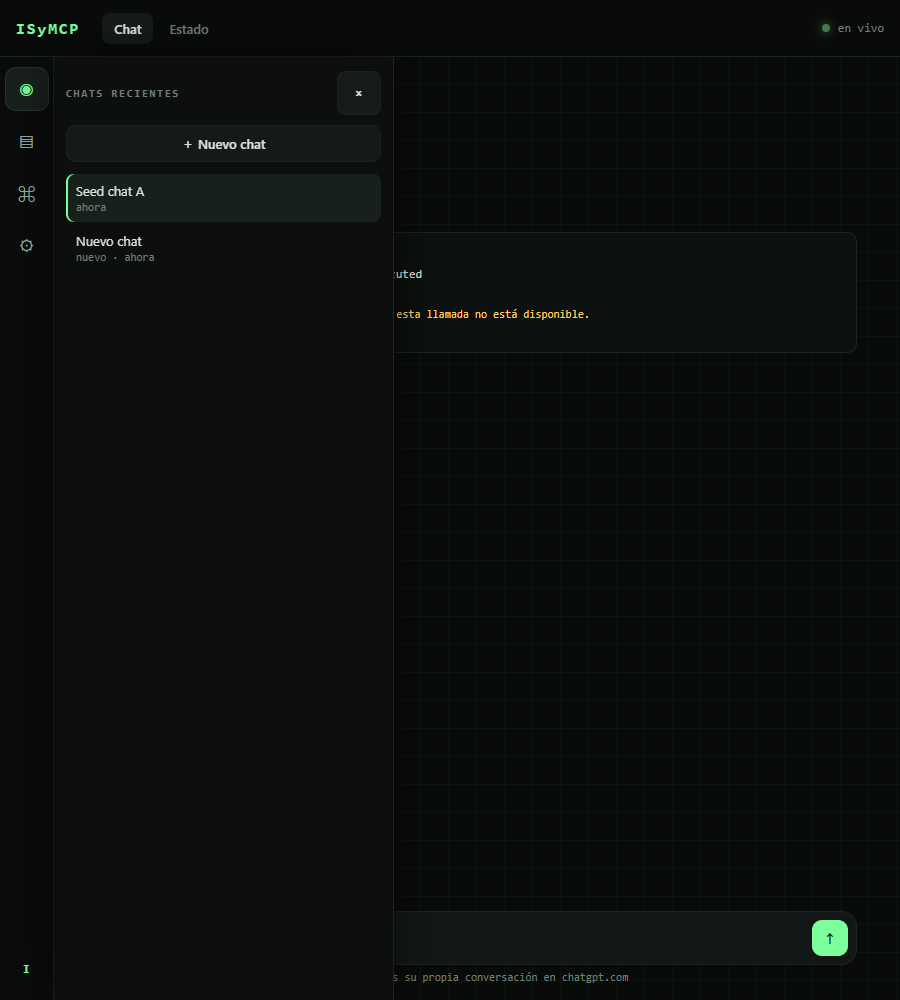
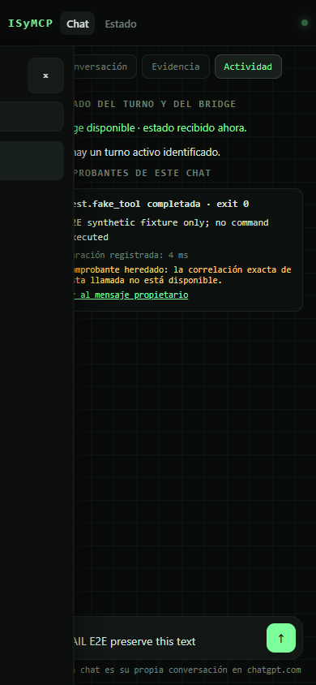

# Panel chat views — verification record

Date: 2026-10-15
Host: Windows, Bun 1.4.2, local Google Chrome
Scope: chat workspace panel, three views, drafts, Blossom asset, responsive drawers and receipt projection.

## Results

- **Focused panel/chat suite:** PASS — `bun test --timeout 60000 tests/chat-phase2-tools.test.ts tests/chat.test.ts tests/panel-chat-modes.test.ts tests/panel-integrations.test.ts tests/panel.test.ts` ran 58 tests, 0 failures and 407 assertions. It includes the regression that proves raw MCP traces redact `client_secret`, `secret_key`, `client_key`, and `private_key`. The exact output is in [the focused test log](../evidence/panel-chat-views-focused-tests-2026-10-15.txt).
- **Post-review regression rerun:** PASS — `bun test --timeout 90000 tests/chat-phase2-tools.test.ts tests/panel-chat-modes.test.ts tests/panel-browser-e2e.test.ts` ran 29 tests across 3 files with 0 failures and 251 assertions. This covers expired-session disable, credential-label redaction at the persistent trace boundary, stale config responses during chat switching, config drawer navigation, and browser E2E.
- **Chrome browser E2E:** PASS — `bun test --timeout 90000 tests/panel-browser-e2e.test.ts` ran 1 test, 0 failures and 48 assertions. The same E2E passed again in the combined post-review regression run. Its wait for persisted drafts polls at 100 ms, and the case allows 90 seconds on this Windows host. The browser uses a local fake bridge; the generated receipt is explicitly labelled `E2E synthetic fixture only; no command executed`.
- **Visual review:** rendered and inspected at 1440 px, 900 px and 390 px. The E2E checked that the document does not overflow horizontally, exercised both responsive drawers, Escape, focus entry/restoration, draft recovery, evidence filters and the local Blossom image. Screenshots are below.
- **Repository suite:** EXECUTED before the final trace-sanitization follow-up — `bun test --timeout 60000` ran 582 tests across 87 files: 490 passed, 7 skipped and 85 failed (2,228 assertions). The final follow-up is covered by the focused suite and the post-review rerun above. See the [suite summary](../evidence/panel-chat-views-full-suite-summary-2026-10-15.txt); the raw output remains at `D:\CodexTemp\isymcp-full-tests.txt` with SHA-256 `F3A60F2AB0A2A1863AADFECEA7DB9BDC9797338D8437E522C51FECA26B6B687E`.

The 85 full-suite failures were outside the changed panel test files. This Windows host lacks several dependencies expected by unrelated suites, including `ffmpeg`, Docker Desktop/the sandbox image, a `codex` executable on PATH, and POSIX command/path assumptions. Other failures include Linux-only `/usr/bin/google-chrome` lookup, symlink creation denied by the host, and POSIX `0600` mode assertions reading as Windows mode `0666`. The focused suite and panel browser E2E both pass. The full repository suite is therefore **not green on this host**; the log preserves each failure.

## Browser E2E coverage

The test starts the actual panel HTTP server, a deterministic local fake bridge and headless Chrome. It verifies chat creation and selection, explicit message submission, fake response rendering, per-chat draft persistence across switching/reload, `pagehide` flush overtaking an older in-flight write, server rejection of stale revisions, safe composer state during a delayed chat load, selecting a read-only session while tools remain OFF, saved/live receipt views, filters, owning-message links, failed-send text retention, keyboard drawers and the local Blossom file. Browser requests stay on the panel's loopback origin.

**Real ChatGPT canary: `NOT_DEMONSTRATED`.** No authenticated ChatGPT bridge turn was sent. A fake bridge and synthetic receipt demonstrate the panel/API lifecycle only; they do not establish live ChatGPT compatibility or execute a command.

## Screenshots

These screenshots contain synthetic demo content from the local fake bridge.

### Desktop conversation — 1440 px

### Desktop evidence — 1440 px

### Tablet history drawer — 900 px

### Mobile history drawer — 390 px

## SHA-256

| Artifact | SHA-256 |
|---|---|
| Focused test log | `72BBA289C3F659D0BFBABC015167247DE3621FBB2C5B9144BD98B558AEEAD05A` |
| Full suite raw log (local evidence) | `F3A60F2AB0A2A1863AADFECEA7DB9BDC9797338D8437E522C51FECA26B6B687E` |
| Desktop conversation screenshot | `374101C5A4CA73C71E9684EBFB587C36220B4C61BD9845EDAD10236BC6CD9A51` |
| Desktop evidence screenshot | `2B0A7F032BE44BC66964D7EBE64E255167745D2E42E74AA51197EE05DB859527` |
| Tablet history screenshot | `1E38E23B796360C85ED714F176EAE231E726141D94783A31D6A1C1A6F07BB8C3` |
| Mobile history screenshot | `629B90435EBCCCB9C725C34FA441ACEFD957D4B14D4BC9BF82B632C014DF1150` |
