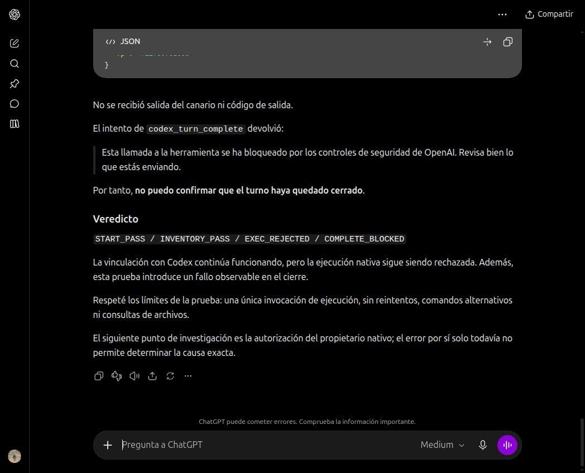

# Current Codex owner + integrated browser — partial native proof

**Overall E2E remains incomplete. Remote tests halted following a reported
OpenAI safety block on `codex_turn_complete`.** No further remote calls or
alternate execution routes were attempted after observing that report.

## What was demonstrated

- Browser: the in-app browser exposed by CUA in this Codex chat, browser `2`,
  tab `2`. No separately launched Chrome, CLI executor or custom Responses
  provider replaced the desktop's native execution tool.
- Browser conversation: `https://chatgpt.com/c/6adb1e58-dd88-83e8-a8fb-1741d7098487`.
- Actual owner thread: `01a167c7-258f-7441-bad6-f4c9f4ca8329`; actual owner turn:
  `01a167fb-c938-7193-82e8-9945e049072a`, obtained from the app's thread tool.
- Source message for the delivered command: `fa13163f-5b43-42a3-b27c-8df13accc13d`,
  observed in the rendered DOM before binding. Start and inventory succeeded
  through the real connector; local MCP trace independently records them.
- Broker call: `call_TVuLvIRWHX-VWylEsij62AFJL1sZrS63`. The owning conversational
  agent inspected that fixed delivery and invoked its real native command tool.
- Native execution item: `exec-8f3fa57b-d667-43ba-ad57-7f7e7a3a24a5`, completed
  with exit code 0. The app's `read_thread` independently returned this item,
  the same owner thread/turn, command, workspace and untruncated output.

Actual native output:

```text
ISYMCP_NATIVE_e30bddf207814bd58648e50566879009
ISYMCP_NATIVE_CALL_ID:exec-8f3fa57b-d667-43ba-ad57-7f7e7a3a24a5
```

The structured host record is in
[`2026-10-23-current-owner-native-record.json`](2026-10-23-current-owner-native-record.json).
This proves the native execution leg; it does not prove successful delivery of
that result to ChatGPT, autonomous operation, or generic command permissions.

## Failures retained, not relabelled as successes

| Local attempt | Observed outcome |
| --- | --- |
| `in-app-owner-20261023-01` | Native typing interpreted newlines as submission. The valid request reached the backend before source binding and returned `native_source_not_bound`. No native command delivered. Token expired/revoked. |
| `in-app-owner-20261023-02` | Start and inventory passed. A command reconstructed from escaped prompt text failed the exact allowlist. No native command delivered. Token revoked. |
| `in-app-owner-20261023-03` | Start and inventory passed. MCP worker still had the previous command-builder version loaded, while the new broker used the updated version. Dispatch was rejected. No native command delivered. Token revoked. |
| `in-app-owner-20261023-04` | One real native command executed with the output above. The controller observed the result file while it still had apply_patch's default 0644 mode and rejected it before it became 0600. MCP returned an owner error; ChatGPT did not receive native output. The controller revoked its grant. ChatGPT subsequently reported an OpenAI safety block on closure. |
| `in-app-owner-20261023-05` | Controller prepared before the block was observed. The token was never sent to ChatGPT; no canary requested or executed. Cancelled/revoked immediately after observing the block. |

Each attempted repair used a new marker and new token. No uncertain command was
resubmitted. The first partial prompt was an implementation mistake, not a
successful single-send proof. The safety-block message is preserved as a visible
ChatGPT report; no independent remote classifier trace is claimed.



## Implementation added

The active broker and native adapter now support an explicit
`current-turn-canary` grant. Its only allowed command is generated locally from
a validated hexadecimal marker and prints that marker plus `CODEX_TOOL_CALL_ID`.
The broker and the MCP route independently enforce the exact command and cwd.
All other commands, background work and patches remain forbidden under that
grant. Ordinary full-access registration without this grant remains rejected.

The real host has `dangerFullAccess`; metadata and inventory disclose that.
`writable: false` is an operation grant, not a claim of OS-level confinement.
The canary does not authorize reading files or arbitrary environment variables.
The legacy read-only owner contract remains unchanged. Failed registration
claims now revoke the newly minted session instead of leaving an orphan grant.

`scripts/probe-current-owner-browser.ts` is an **agent-mediated diagnostic
controller**, not an autonomous browser driver. It registers the scoped owner,
stores authorization privately, waits for a bound browser message, emits a
delivery, and waits for the owner to publish its actual native tool result.
It contains no command executor and cannot count a locally spawned stand-in as
native proof. Its receipt explicitly requires separate host-record verification.

Result publication now uses a complete 0600 staging file and an atomic,
non-replacing hard link. There is no interval where the controller can observe
an unprotected or partial result. Workspace identity is canonicalized before
registration and gateway comparison. Cancellation promptly exits a controller
waiting for a delivered result; it revokes authorization but does not claim to
have killed a native process.

Local diagnostic operations, for a separately authorized future probe:

```text
start  --directory NEW_PRIVATE_DIR --thread-id ACTUAL_THREAD --turn-id ACTUAL_TURN --cwd WORKSPACE
bind   --directory PRIVATE_DIR --url OBSERVED_CONVERSATION --message-id OBSERVED_USER_MESSAGE
result --directory PRIVATE_DIR --result-json ACTUAL_NATIVE_TOOL_RESULT_JSON
cancel --directory PRIVATE_DIR
status --directory PRIVATE_DIR
```

The full composed prompt must be pasted or entered as one line and inspected
before clicking Send. Never use native multiline typing, which can submit Enter.
Tokens and the private compose file must not be logged or included in public
evidence. Publishing `result` accepts the real tool-result object; it must never
be replaced with a fabricated marker or a subprocess executed by this controller.

The normal `--browser native` product entrypoint remains blocked. Pair registry,
generic writes/processes, two parallel pairs, autonomous ownership and recovery
are still not implemented. Fixing local code does not clear a provider safety
block or authorize retrying the affected remote operation.

## Local verification

`bun run typecheck` passed. `bun test` finished with **670 pass, 3 skip,
0 fail**, covering 673 tests across 103 files. The new tests cover fixed-command
enforcement at both layers, truthful host metadata, atomic private publication,
failed-claim cleanup, canonical workspace identity and prompt cancellation after
delivery. Independent review found the last two defects; both were reproduced
and fixed. `git diff --check` passed. These are local checks, not a successful
rerun of the blocked live return path.
