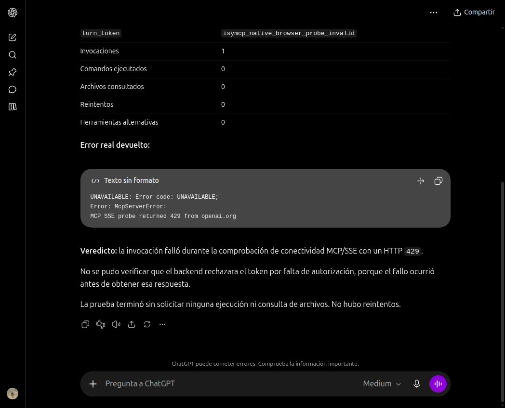

# Native browser E2E — capability gate, 2026-10-23

Status: **BLOCKED / INCOMPLETE**. This is the first milestone of the user-approved
native-browser plan, not an implementation of the complete two-pair system.

Follow-up: a fixed canary subsequently executed in this chat's real native tool,
independently confirmed by the app's thread record. Its MCP return failed and
the closure was reported blocked by OpenAI; remote testing was halted. See the
[partial native proof and retained failures](2026-10-23-current-owner-browser.md).

## Capability matrix

| Capability | Evidence | Result |
| --- | --- | --- |
| Open and operate ChatGPT in the active Codex chat's in-app browser | CUA inventory identifies the in-app browser and the current Codex session; a separate tab was opened, the actual Codex ISyMCP mention selected and one prompt submitted | Demonstrated |
| Authenticated ChatGPT conversation | New conversation at `https://chatgpt.com/c/6adb17c9-4a10-83e8-9f4c-0fe20746f577` | Demonstrated |
| Browser → MCP connectivity | Negative canary `ISYMCP_NATIVE_BROWSER_GATE_20261023` asked only for `codex_turn_start` with a deliberately invalid, non-authorizing identifier | Failed / no successful tool receipt |
| Error from the browser canary | ChatGPT's visible final answer reports `UNAVAILABLE: Error code: UNAVAILABLE; Error: McpServerError: MCP SSE probe returned 429 from openai.org` | Reported by ChatGPT; raw remote call/result not independently captured |
| Existing tunnel runtime | Tunnel MCP status initially reported stopped; the existing alias `isymcp-native-media` was reconnected with the existing tunnel ID, MCP command and runtime credential reference | Follow-up status: process running, healthy and ready; control-plane poll health unknown |
| Active chat → native execution owner | Existing protocol-5 adapter requires a registered owner, only permits read-only foreground commands, and has no adapter registering this chat's native tool registry | Not demonstrated |
| Autonomous native-browser control | Installed `codex-cli 0.162.0` experimental ClientRequest schema declares 170 methods, none named under browser/tab namespaces | No verified external adapter; absence of named methods is not proof that no other product interface exists |
| Native patch, long-running process, two simultaneous pairs and recovery | Depend on the missing owner/browser integration | Not attempted; no E2E success claimed |

The negative canary did not request local command execution, file reads or a
valid grant. Its failure does **not** verify token rejection by the local backend.
The remote call was not automatically retried or switched to another executor.
Restoring the stopped runtime is an infrastructure repair, not an E2E receipt.



## Reproducible diagnostic

```bash
isymcp native-browser status --json
isymcp native-browser probe --json
isymcp ask "hello" --browser native
```

`status` exits 0 when it successfully describes the current blocked implementation.
`probe` exits 2 while E2E is unverified. It exports the installed app-server
schema to a private temporary directory, extracts declared request methods,
reports the version and schema SHA-256, and removes the directory. It does not
start a Codex conversation, open a browser, contact a model, mint a token, change
configuration or start a tunnel. An inspection failure is explicit, never an
optimistic empty capability list. Even a browser-named RPC does not mark a mode
ready without a live adapter and correlated receipt.

Panel `GET /api/native-browser/status` exposes the same gate behind the existing
loopback Host/Origin checks. `POST /api/chats/:id/messages` and direct bridge
`POST /isymcp/chat/turn` accept an explicit `browser: "native"` selection and
currently return 503 `native_browser_unavailable` before dispatching. The CLI
does the same before checking the bridge, reading stdin or creating a chat.
Unknown browser selections are rejected. Requests with no explicit selection
retain the existing behavior. No persistent chat browser preference is added.

## Implementation boundary and next gate

The implementation adds diagnostics and prevents a silent downgrade; it does
not implement a native browser driver, execution owner, pair registry or event
stream. Token permissions, the protocol-5 broker and the legacy queues remain
unchanged. Native writes/processes must not be enabled merely to satisfy tests.

To proceed, supply a documented, authorized owner adapter that exposes the real
desktop tool registry and can service MCP calls while independently observing
its explicitly bound tab. Prove one foreground native read and its MCP return
against the same owner, conversation and user message. Separately prove panel/CLI
startup and recovery of an autonomous desktop owner and its tab. If that interface
is unavailable, the autonomous mode remains blocked as the approved plan requires.
Only then implement the remaining permissions, pair isolation and concurrency
milestones. CLI app-server execution is not substituted for a desktop owner.

## Validation record

Before edits: `bun test` reported 651 pass, 3 skip and 2 fail (656 tests / 99
files). Existing failures were `Unified E2E Smoke Suite > ejecuta la suite e2e
completa y pasa todas las verificaciones` (30-second timeout) and `M3: runDoctor >
runDoctor real no lanza y siempre reporta node` (7.7-second timeout).

The four new entrypoint tests first failed: unknown status command, native CLI
request reaching the legacy bridge, native panel request reaching the legacy
bridge, and status endpoint returning panel HTML. They passed after the gate
was implemented. Additional coverage exercises malformed options, unsupported
browser selections, failed schema inspection, a browser-named protocol that must
not enable readiness, and rejection by the direct bridge route.

Final verification: `bun run typecheck` passed. `bun test` passed with **663
pass, 3 skip, 0 fail**, 666 tests across 101 files (68.42 seconds). The two
baseline timeouts did not recur. `git diff --check` passed. A fresh independent
review found no actionable issues in the capability-gate changes. These results
verify the diagnostics and dispatch guards, not the deferred native-browser E2E.
