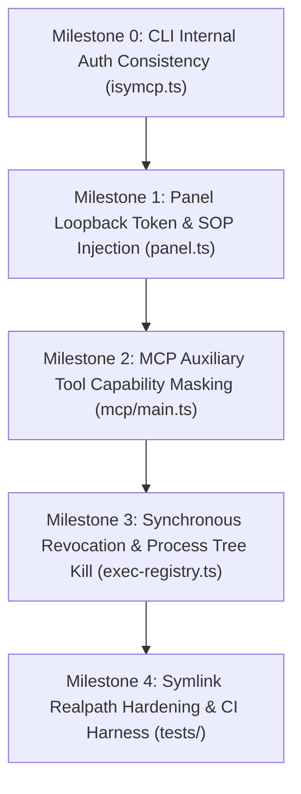

# Implementation Plan: ISyMCP v1.0.1 Security Boundary Hardening

* **Document:** `implementation_plan.md`
* **Status:** Ready for Execution (Awaiting Separate Approval)
* **Target Version:** ISyMCP v1.0.2 / v1.1.0 Hardening Release
* **Execution Gates:** Read-Only Inspection Completed; No Production Changes during this phase.
* **Related RFC:** [`security_boundary_rfc.md`](file:///home/danny/Development/ISyCo%20Git/chatgpt-http-mcp-impl/security_boundary_rfc.md)

---

## 1. Guiding Principles & Non-Destructive Invariants

1. **Surgical, Minimal Edits**: No architectural rewrites of working subsystems. Touch only the exact functions responsible for the identified trust-boundary gaps.
2. **Strict Zero-Downtime Backward Compatibility**:
   - OpenAI Custom GPT schemas must remain untouched.
   - Official Codex protocol-5 broker integration must not change.
   - Web panel browser workflows (bookmarks, refresh, tabs) must remain smooth.
3. **Reversible Rollback at Runtime**: Every hardening mechanism is guarded by environment flags, defaulting to `strict`, with an immediate one-switch fallback to `v1_compat`.
4. **Adversarial Test Verification First**: Each milestone is accompanied by falsifiable negative tests that must pass before advancing to subsequent milestones.

---

## 2. Milestone Sequence & Dependency Graph



---

## 3. Milestone Specifications

### Milestone 0: CLI Internal Authentication Consistency
* **Objective:** Fix CLI self-denial on protected bridge routes where internal commands issue unauthenticated requests to `server.ts:8791`.
* **Prerequisites:** Existing `src/local-guard.ts` exports `bridgeAuthHeaders()`.
* **Affected Files & Line Targets:**
  - [`src/isymcp.ts`](file:///home/danny/Development/ISyCo%20Git/chatgpt-http-mcp-impl/src/isymcp.ts#L231, #L248-L251, #L280-L286)
* **Concrete Changes:**
  1. In `bridgeJson(path, method, body)`, attach `bridgeAuthHeaders()`:
     ```ts
     const res = await fetch(`http://127.0.0.1:${PORT}${path}`, {
       method,
       headers: bridgeAuthHeaders({ "content-type": "application/json" }),
       body: body ? JSON.stringify(body) : undefined,
     });
     ```
  2. In `askChatGPT(prompt)`, ensure the fetch request includes `bridgeAuthHeaders()`.
* **Verification Gate:**
  - Execute `bun run src/isymcp.ts ask "test"` against a running bridge. Must return HTTP 200 / valid reply without HTTP 401.
* **Rollback Switch:** N/A (non-breaking bugfix for existing documented behavior).

---

### Milestone 1: Panel Loopback Token Hardening & Cookie Confinement
* **Objective:** Protect panel administrative routes against unauthenticated local callers while ensuring zero friction for browser users and eliminating any token oracle in the DOM.
* **Prerequisites:** Milestone 0 complete; `src/local-guard.ts` available.
* **Affected Files & Line Targets:**
  - [`src/panel.ts`](file:///home/danny/Development/ISyCo%20Git/chatgpt-http-mcp-impl/src/panel.ts)
  - [`src/local-guard.ts`](file:///home/danny/Development/ISyCo%20Git/chatgpt-http-mcp-impl/src/local-guard.ts)
  - [`src/isymcp.ts`](file:///home/danny/Development/ISyCo%20Git/chatgpt-http-mcp-impl/src/isymcp.ts)
* **Concrete Changes:**
  1. **Single-Use Bootstrap Ticket Exchange:**
     - In `src/panel.ts`: Add `mintPanelTicket(ttlMs)` and `redeemPanelTicket(ticket)`.
     - In `startPanel()`: Handle `GET /?ticket=<uuid>`, consume ticket, issue HMAC-signed `isymcp_session` `HttpOnly; SameSite=Strict` cookie, redirect (302) to `/`.
     - Add `POST /api/ticket` (requires `bridgeToken()`) for launcher.
     - Add `POST /api/login` (accepts token, issues cookie).
  2. **Zero DOM Secrets:**
     - Remove `window.__ISYMCP_TOKEN__` completely from DOM HTML, scripts, and runtime.
     - Unauthenticated `GET /` serves a clean login card (`renderLoginCard()`) with HTTP 200 containing zero secrets.
  3. In `src/panel.ts:startPanel()`: For mutating routes (`/api/action`, `/api/harness/apply`, `/api/chats/*`, `/api/settings/*`):
     ```ts
     const requireToken = authStrict && isMutating;
     const denied = guardLocalRequest(req, { requireToken, allowCookie: true, requireJsonBody: isMutating, loopbackOnly: true });
     if (denied) return denied;
     ```
  4. In `src/isymcp.ts:openPanel()`: Mint single-use ticket and open `http://127.0.0.1:8798/?ticket=${ticket}`.
* **Verification Gate:**
  - Run `tests/panel.test.ts` and `tests/security-boundary.test.ts`.
  - Execute `SEC-TEST-03`, `SEC-TEST-04`, `SEC-TEST-11`: unauthenticated `curl -X POST http://127.0.0.1:8798/api/action` returns HTTP 401; unauthenticated `curl http://127.0.0.1:8798/` returns login card with zero secrets.
* **Rollback Switch:**
  - Set `CODEX_WEB_HTTP_PANEL_AUTH=off` to restore v1.0.1 unauthenticated behavior.

---

### Milestone 2: MCP Auxiliary Tool Capability Masking
* **Objective:** Prevent unauthenticated media downloads (`yt-dlp`) and GPU computation (`comfyui`) over public Cloudflare tunnel transports.
* **Prerequisites:** Milestone 1 complete.
* **Affected Files & Line Targets:**
  - [`src/mcp/main.ts`](file:///home/danny/Development/ISyCo%20Git/chatgpt-http-mcp-impl/src/mcp/main.ts#L748-L751)
  - [`src/media/register.ts`](file:///home/danny/Development/ISyCo%20Git/chatgpt-http-mcp-impl/src/media/register.ts#L38-L44)
* **Concrete Changes:**
  1. In `src/mcp/main.ts`, gate auxiliary tool registration:
     ```ts
     const exposeAux = process.env.CODEX_WEB_HTTP_EXPOSE_AUX_TOOLS === "true" ||
                       process.env.CODEX_WEB_HTTP_SECURITY_PROFILE === "v1_compat";
     if (exposeAux) {
       registerMediaTools(server);
       registerComfyTools(server);
     }
     ```
  2. In `src/media/service.ts`, if media tools are enabled on public tunnels, constrain output download paths strictly to the workspace directory (`session.cwd`), preventing escapes into global `~/.codex-web-http/media`.
* **Verification Gate:**
  - Execute `SEC-TEST-05`: MCP tool listing excludes `media_import` and `comfyui_generate` by default.
  - Core 8 Codex tools remain fully functional.
* **Rollback Switch:**
  - Set `CODEX_WEB_HTTP_EXPOSE_AUX_TOOLS=true` to restore public tunnel registration.

---

### Milestone 3: Synchronous Revocation & Process Tree Kill
* **Objective:** Eliminate background process zombies across Linux and Windows and enable safe multi-turn background task management.
* **Prerequisites:** Milestone 2 complete.
* **Affected Files & Line Targets:**
  - [`src/mcp/exec-registry.ts`](file:///home/danny/Development/ISyCo%20Git/chatgpt-http-mcp-impl/src/mcp/exec-registry.ts#L144-L154, #L177-L199, #L298-L305)
  - [`src/mcp/main.ts`](file:///home/danny/Development/ISyCo%20Git/chatgpt-http-mcp-impl/src/mcp/main.ts#L236-L237, #L431-L455)
* **Concrete Changes:**
  1. **Canonical Root Session Indexing**:
     In `src/mcp/main.ts:236`:
     ```ts
     const rootFp = session.parent ?? session.fp;
     const rec = registerLiveExec({ sessionFp: rootFp, command: args.command, cwd: session.cwd, proc });
     ```
  2. **Synchronous Revocation Check in `findLive()` & `runWriteStdin()`**:
     In `src/mcp/exec-registry.ts:findLive(id)`:
     ```ts
     const rec = live.get(id);
     if (!rec) return null;
     if (process.env.CODEX_WEB_HTTP_CASCADE_KILL !== "false") {
       const sessions = readSessions();
       const parent = sessions.find((s) => s.fp === rec.sessionFp && !isExpired(s));
       if (!parent) {
         killExec(rec);
         return null;
       }
     }
     return rec;
     ```
  3. **Fast Sweeper Active Reconciliation**:
     In `sweepLiveExecs()`: cross-reference `live.values()` against `readSessions()`. Terminate any `rec` whose `sessionFp` is missing from disk or expired.
  4. **Cross-Platform Process Tree Kill**:
     In `killUnregisteredProc`:
     ```ts
     if (process.platform === "win32") {
       stopProcessTree(proc.pid);
     } else {
       try {
         process.kill(-proc.pid, "SIGKILL");
       } catch {
         proc.kill(9);
       }
     }
     ```
* **Verification Gate:**
  - Execute `SEC-TEST-06`, `SEC-TEST-07`, `SEC-TEST-08`, and `SEC-TEST-10`.
  - Revoking a session terminates background tasks within 1 second.
  - Multi-turn prompts can write stdin to Turn 1 tasks.
* **Rollback Switch:**
  - Set `CODEX_WEB_HTTP_CASCADE_KILL=false` to revert to time-only background sweeper.

---

### Milestone 4: Symlink Realpath Hardening & CI Test Suite
* **Objective:** Prevent symlink directory escapes in patch operations and integrate automated regression tests.
* **Prerequisites:** Milestones 0–3 complete.
* **Affected Files & Line Targets:**
  - [`src/mcp/main.ts`](file:///home/danny/Development/ISyCo%20Git/chatgpt-http-mcp-impl/src/mcp/main.ts#L319-L323)
  - [`tests/security-boundary.test.ts`](file:///home/danny/Development/ISyCo%20Git/chatgpt-http-mcp-impl/tests/security-boundary.test.ts) (New File)
* **Concrete Changes:**
  1. In `src/mcp/main.ts:runApplyPatch`: Replace `resolveWithin` with `resolveWithinReal` to resolve realpaths and block symlink traversal outside `session.cwd`.
  2. Create test harness `tests/security-boundary.test.ts` implementing all 10 tests from `security_test_matrix.md`.
* **Verification Gate:**
  - Run full test suite: `bun test`.
  - All unit tests and adversarial boundary tests pass with 0 failures.
* **Rollback Switch:** N/A (all changes fail-closed and test-verified).

---

## 4. Master Configuration Flags & Operational Fallback

| Environment Variable | Allowed Values | Default | Purpose / Fallback Behavior |
| :--- | :--- | :--- | :--- |
| `CODEX_WEB_HTTP_SECURITY_PROFILE` | `strict` \| `v1_compat` | `strict` | Master switch. Setting `v1_compat` reverts all boundaries to v1.0.1 behavior. |
| `CODEX_WEB_HTTP_PANEL_AUTH` | `strict` \| `off` | `strict` | Controls loopback token enforcement on panel mutating endpoints. |
| `CODEX_WEB_HTTP_EXPOSE_AUX_TOOLS` | `true` \| `false` | `false` | Controls whether auxiliary media/comfy tools are registered on public tunnel MCP server. |
| `CODEX_WEB_HTTP_CASCADE_KILL` | `true` \| `false` | `true` | Controls synchronous pre-execution revocation check and process tree termination. |

---

## 5. Execution Summary Table

| Milestone | Target Component | Core Security Invariant | Breaking Risk | Estimated Effort |
| :---: | :--- | :--- | :---: | :---: |
| **M0** | CLI Daemon Client (`src/isymcp.ts`) | Internal credential parity | None (Fixes 401 bug) | 15 mins |
| **M1** | Web Panel (`src/panel.ts`, `src/panel-chat.ts`) | **INV-1**: Confused deputy loopback protection | Low (Protected by SOP) | 30 mins |
| **M2** | Auxiliary MCP Tools (`src/mcp/main.ts`) | **INV-2**: Zero unauthenticated public tunnel exposure | None (Custom GPT schema preserved) | 20 mins |
| **M3** | Background Process Lifecycle (`src/mcp/exec-registry.ts`) | **INV-3, INV-4, INV-5**: Immediate revocation & tree kill | Low (Sub-millisecond disk read) | 45 mins |
| **M4** | Symlink Realpath & CI Test Suite (`tests/security-boundary.test.ts`) | **INV-6**: Symlink directory escape prevention | None (New test suite) | 35 mins |
