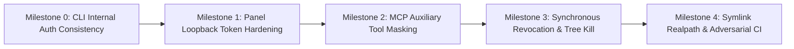

# RFC: ISyMCP v1.0.1 Security Boundary Hardening

* **Status:** Proposed / Implementation-Ready
* **Author:** DannyBaanks
* **Target Version:** ISyMCP v1.0.2 / v1.1.0 Hardening Release
* **Date:** 2026-11-07
* **Related Documents:** [`concepts_brief.md`](file:///home/danny/Development/ISyCo%20Git/chatgpt-http-mcp-impl/concepts_brief.md), [`goldfish_adversarial_review.md`](file:///home/danny/Development/ISyCo%20Git/chatgpt-http-mcp-impl/goldfish_adversarial_review.md), [`security_test_matrix.md`](file:///home/danny/Development/ISyCo%20Git/chatgpt-http-mcp-impl/security_test_matrix.md), [`implementation_plan.md`](file:///home/danny/Development/ISyCo%20Git/chatgpt-http-mcp-impl/implementation_plan.md)

---

## 1. Executive Summary

An architectural security audit of ISyMCP v1.0.1 (`chatgpt-http-mcp-impl`) utilizing the Elephant-Goldfish Model (EGM) demonstrated that core workspace command execution (`codex_exec`, `codex_apply_patch`) enforces strict authorization boundaries and fails closed when tokens are missing, malformed, or expired.

However, the audit revealed three systemic trust-boundary inconsistencies:
1. **Unauthenticated Loopback Administrative Plane (`src/panel.ts`)**: The visual panel server on port 8798 omits token enforcement (`requireToken: false`), enabling any unprivileged local process on loopback to trigger host subprocess execution (`/api/action`), rewrite agent harness configurations (`/api/harness/apply`), or proxy chat turns to the bridge server using internal credentials.
2. **Unauthenticated Capabilities on Public Tunnels (`src/media/register.ts`, `src/comfyui/register.ts`)**: While Codex tools mandate session tokens, media downloaders (`yt-dlp` via `media_import`) and GPU rendering tools (`comfyui_generate`) are registered on public Cloudflare tunnel transports without authentication, enabling remote prompt injections to download up to 500 MiB files or exhaust local host resources.
3. **Decoupled Session Lifecycle & Zombie Process Persistence (`src/mcp/exec-registry.ts`)**: Background processes spawned via `codex_exec` (`background: true`) survive session revocation and token expiration. On Windows, bare `proc.kill(9)` terminates only the wrapper process (`cmd.exe`), leaving child processes (`curl`, `python`, `git`) running as immortal background zombies. Furthermore, multi-turn prompts cannot access previous turn background tasks due to ephemeral turn fingerprint mismatches.

This RFC defines a targeted, non-destructive hardening roadmap that resolves all three inconsistencies while preserving client compatibility with OpenAI Custom GPTs, official Codex protocol-5, Claude Code, and terminal workflows.

---

## 2. Current Architecture & Trust-Boundary Map

ISyMCP coordinates multiple daemon processes, transports, and execution sandboxes. Trust boundaries are structured across four principal tiers:

```mermaid
flowchart TD
    subgraph External ["External Untrusted Boundary"]
        Tunnel["Cloudflare Tunnel / Public Remote Prompts"]
        LocalProcs["Unprivileged Host Processes / Local Origin"]
    end

    subgraph Transports ["Transport & Gateway Layer"]
        HTTPBridge["HTTP/SSE Bridge Server (:8791)"]
        WSBridge["WebSocket Route (/v1/responses)"]
        PanelServer["Panel Web Console (:8798)"]
        MCPStdio["MCP Stdio Protocol (tunnel-client)"]
    end

    subgraph AuthLayer ["Authentication & Guard Layer"]
        LocalGuard["local-guard.ts (Host/Origin + bridgeToken)"]
        PanelGuard["panel.ts (Host/Origin ONLY - requireToken: false)"]
        SessionReg["codex-sessions.json (Session & Turn Tokens)"]
    end

    subgraph ExecutionLayer ["Execution & Sandbox Layer"]
        CodexExec["codex_exec / codex_apply_patch (bwrap / Docker)"]
        MediaTools["media_import / yt-dlp (Host Process, No Sandbox)"]
        ComfyTools["comfyui_generate (Local GPU Daemon)"]
        BgExecs["exec-registry.ts (LiveExec Background Map)"]
        PanelActions["runPanelAction (Host Subprocess Spawn)"]
    end

    Tunnel -->|MCP JSON-RPC| MCPStdio
    LocalProcs -->|HTTP POST| PanelServer
    LocalProcs -->|HTTP POST| HTTPBridge

    HTTPBridge --> LocalGuard
    WSBridge --> LocalGuard
    PanelServer --> PanelGuard

    MCPStdio -->|Codex Tools + turn_token| SessionReg
    SessionReg -->|Valid Session| CodexExec
    SessionReg -->|background: true| BgExecs

    MCPStdio -->|Media / Comfy Tools (NO TOKEN)| MediaTools
    MCPStdio -->|Media / Comfy Tools (NO TOKEN)| ComfyTools

    PanelServer -->|POST /api/action| PanelActions
    PanelServer -->|Proxy turn + bridgeAuthHeaders| HTTPBridge
```

### Trust Boundary Analysis

1. **Boundary T1: External Web / Public Tunnel -> MCP Stdio Server**
   - *Intended Trust Model*: Remote model prompts must possess a valid, unexpired `turn_token` tied to an authorized workspace before executing commands.
   - *Current Implementation Reality*: Codex tools correctly fail closed. However, auxiliary tools (`media_*`, `comfyui_*`) bypass `codex-sessions.json` entirely.
2. **Boundary T2: Local Loopback Host Processes -> HTTP Bridge (:8791)**
   - *Intended Trust Model*: Only authorized internal processes possessing the 0600 file token (`~/.codex-web-http/token`) or matching `CODEX_WEB_HTTP_TOKEN` may communicate with the HTTP/SSE daemon.
   - *Current Implementation Reality*: Correctly enforced via [`guardLocalRequest`](file:///home/danny/Development/ISyCo%20Git/chatgpt-http-mcp-impl/src/local-guard.ts#L174-L220).
3. **Boundary T3: Local Loopback Host Processes -> Panel Web Console (:8798)**
   - *Intended Trust Model*: User interacts visually with local chats, monitors system state, and triggers maintenance actions.
   - *Current Implementation Reality*: `panel.ts` validates `Host` and `Origin` loopback headers and requires `application/json` on POST, but explicitly sets `requireToken: false`. Any local unprivileged process can invoke mutating actions.
4. **Boundary T4: Session Registry -> Process Execution Sandbox**
   - *Intended Trust Model*: Subprocesses execute confined to `session.cwd` inside Bubblewrap (Linux) or Docker / Codex CLI (Windows). Revoking a session terminates all execution authority.
   - *Current Implementation Reality*: Revoking a session removes disk records in `codex-sessions.json`, but in-memory background executions in `exec-registry.ts` are decoupled and continue executing for up to 15 minutes.

---

## 3. Explicit Target Invariants

The hardening roadmap guarantees that the following security invariants hold unconditionally:

1. **INV-1: Unauthenticated Local Mutation Fail-Closed**: No unauthenticated local process or external web context (via CSRF, DNS rebinding, or loopback fetch) can execute mutating panel actions ([`POST /api/action`](file:///home/danny/Development/ISyCo%20Git/chatgpt-http-mcp-impl/src/panel.ts#L686-L689)), modify agent harnesses ([`POST /api/harness/apply`](file:///home/danny/Development/ISyCo%20Git/chatgpt-http-mcp-impl/src/panel.ts#L854-L857)), or proxy turns through the bridge.
2. **INV-2: Zero Public Tunnel Exposure for Auxiliary Host Tools**: Public Cloudflare tunnel transports must never expose unauthenticated host downloader tools (`media_import`) or GPU compute tools (`comfyui_generate`) to remote prompt callers by default.
3. **INV-3: Immediate Capability Revocation**: Revoking a session via `isymcp session revoke <fp>` or session expiration immediately halts execution authority for all associated background processes; subsequent stdin writes or process checks must fail closed synchronously.
4. **INV-4: Complete Cross-Platform Process Tree Elimination**: Terminating a background execution or revoking a session must reliably terminate the entire process hierarchy (supervisor and child processes) on both Linux (process groups) and Windows (process trees).
5. **INV-5: Multi-Turn Continuity Preservation**: Multi-turn prompts operating under ephemeral turn tokens derived from the same parent session must retain valid access to manage background tasks created in earlier turns.
6. **INV-6: Strict Symlink Realpath Confinement**: File modification tools (`codex_apply_patch`) must never write through symlinks pointing outside the authorized workspace directory.

---

## 4. Decoupling & Hardening Architectural Design

### Architectural Decision A: Panel Authentication Hardening
* **Adversarial Critique of Initial Proposal**:  
  Injecting `window.__ISYMCP_TOKEN__ = bridgeToken()` into the HTML DOM (as proposed in initial brainstorming) introduces a critical token oracle flaw: Same-Origin Policy confines cross-origin web scripts, but loopback binding provides zero defense against unauthorized local host processes. Any local process or background agent could issue `curl http://127.0.0.1:8798/`, scrape the token from HTML, and leverage it to execute arbitrary commands via `/api/action`.
* **Adopted Hardening Architecture**:  
  **Single-Use Bootstrap Ticket -> Signed `HttpOnly` Session Cookie (Zero Secrets in DOM).**
  1. The HTML shell rendered by `renderPanel()` contains **zero secrets** and no `window.__ISYMCP_TOKEN__`.
  2. Direct navigation to `GET /` without credentials returns HTTP 200 with an unauthenticated login card (`renderLoginCard()`), completely preventing credential extraction by local unprivileged callers.
  3. When an operator runs `isymcp panel` from the terminal, the CLI mints a single-use UUID ticket via `POST /api/ticket` (authenticated by the private local bridge token) and opens `http://127.0.0.1:8798/?ticket=<uuid>`.
  4. The panel burns the ticket immediately upon arrival (`redeemPanelTicket`), generates an HMAC/SHA-256 signed session cookie (`isymcp_session=...`), sets it with `HttpOnly; SameSite=Strict; Path=/; Max-Age=2592000`, and issues a `302 Found` redirect to clean `/`. This survives browser reloads (`F5`) and tab duplicates across server restarts while keeping the URL clean in browser history.
  5. All mutating backend endpoints (`/api/action`, `/api/harness/apply`, `/api/chats/*`, `/api/settings/*`) enforce `guardLocalRequest(req, { requireToken: true, allowCookie: true, requireJsonBody: true, loopbackOnly: true })`.
  6. **Strategic Evolution (v2.0)**: Consolidate panel routes directly into `src/server.ts:8791/panel` to eliminate the secondary daemon and port footprint.

### Architectural Decision B: Auxiliary MCP Tool Isolation
* **Adversarial Critique of Initial Proposal**:  
  Adding `turn_token: z.string()` to the parameter schema of `media_import` was rejected because:
  - It breaks existing OpenAI Custom GPT Action schemas deployed in OpenAI's GPT builder. ChatGPT models do not know or possess internal developer turn tokens for media tools.
  - Forcing end-users to mint session tokens via CLI and paste them into ChatGPT chat prompts destroys the consumer UX.
  - "Metadata" tools (`audio_scan`, `video_contact_sheet`) spawn heavy `ffmpeg` jobs that can DoS the host even if downloads are gated.
* **Adopted Hardening Architecture**:  
  **Transport-Level Capability Masking.**
  1. In [`src/mcp/main.ts`](file:///home/danny/Development/ISyCo%20Git/chatgpt-http-mcp-impl/src/mcp/main.ts#L748-L751), auxiliary tools are gated behind an explicit environment variable:
     ```ts
     if (process.env.CODEX_WEB_HTTP_EXPOSE_AUX_TOOLS === "true") {
       registerMediaTools(server);
       registerComfyTools(server);
     }
     ```
  2. By default, public Cloudflare tunnel transports register **only** the 8 official Codex workspace tools.
  3. Auxiliary tools remain accessible locally for CLI commands (`isymcp media prepare`), the panel UI, and local agent harnesses.
  4. If an operator explicitly enables auxiliary tools on tunnels, mutating downloads must be restricted to write strictly within an active session workspace (`session.cwd`), preventing writes to global `~/.codex-web-http/media`.

### Architectural Decision C: Synchronous Session Revocation & Lifecycle Management
* **Adversarial Critique of Initial Proposal**:  
  Separating authorization invalidation from process cleanup and relying solely on the 30-second sweeper was rejected because:
  - A 30-second delay allows data exfiltration or malicious scripts (which finish in 2–4 seconds) to complete unhindered.
  - `proc.kill(9)` on Windows only terminates the parent shell, leaving descendant processes (`curl`, `python`, `git`) running as orphaned zombies.
  - In-memory `LiveExec` checks do not prevent TOCTOU races when `codex_write_stdin` is called with an already-issued turn token.
* **Adopted Hardening Architecture**:  
  **Synchronous Pre-Execution Validation + OS Process Tree Termination.**
  1. **Canonical Root Session Indexing**: In `src/mcp/main.ts:236`, `LiveExec` records are indexed by canonical parent fingerprint:
     ```ts
     const rootFp = session.parent ?? session.fp;
     ```
     This allows subsequent turn tokens with `turnSession.parent === rootFp` to validly control background executions.
  2. **Synchronous Fail-Closed Verification**: In [`findLive(id)`](file:///home/danny/Development/ISyCo%20Git/chatgpt-http-mcp-impl/src/mcp/exec-registry.ts#L144-L154) and [`runWriteStdin()`](file:///home/danny/Development/ISyCo%20Git/chatgpt-http-mcp-impl/src/mcp/main.ts#L431-L455), the active root fingerprint is validated against `codex-sessions.json` on disk (< 0.2 ms). If the root session is missing, expired, or tombstoned, `killExec(rec)` is executed immediately and the operation fails closed.
  3. **Fast Sweeper Reconciliation**: In `sweepLiveExecs()`, the active live process map is cross-referenced against `readSessions()`. Any process whose root session no longer exists on disk is terminated immediately.
  4. **Cross-Platform Process Tree Termination**:  
     - **Linux**: In `killUnregisteredProc`, terminate process groups via `process.kill(-pid, "SIGKILL")`.
     - **Windows**: Route termination through the existing [`stopProcessTree(pid)`](file:///home/danny/Development/ISyCo%20Git/chatgpt-http-mcp-impl/src/platform/process.ts#L46-L55) utility (`taskkill.exe /F /T /PID <pid>`), guaranteeing that all child processes are killed.

---

## 5. Implementation Roadmap & Contiguous Milestones

The hardening roadmap is structured into 5 contiguous, minimally invasive milestones:



### Milestone 0: CLI Internal Authentication Consistency
* **Objective**: Fix CLI self-denial on protected bridge routes.
* **Affected Files**: [`src/isymcp.ts`](file:///home/danny/Development/ISyCo%20Git/chatgpt-http-mcp-impl/src/isymcp.ts)
* **Changes**:
  - Update `bridgeJson(path, method, body)` to include `bridgeAuthHeaders()`.
  - Update `askChatGPT()` fetch call to include `bridgeAuthHeaders()`.
* **Verification Gate**: `bun run src/isymcp.ts ask "ping"` succeeds without HTTP 401 when the bridge is running.

### Milestone 1: Panel Loopback Token Hardening
* **Objective**: Protect panel administrative routes against unauthenticated local callers without leaking tokens in the DOM or breaking browser UX.
* **Affected Files**: [`src/panel.ts`](file:///home/danny/Development/ISyCo%20Git/chatgpt-http-mcp-impl/src/panel.ts), [`src/local-guard.ts`](file:///home/danny/Development/ISyCo%20Git/chatgpt-http-mcp-impl/src/local-guard.ts), [`src/isymcp.ts`](file:///home/danny/Development/ISyCo%20Git/chatgpt-http-mcp-impl/src/isymcp.ts)
* **Changes**:
  - Implement single-use bootstrap ticket generator (`mintPanelTicket`) and redeemer (`redeemPanelTicket`).
  - Implement HMAC-signed `isymcp_session` session cookie with `HttpOnly; SameSite=Strict; Path=/`.
  - Remove all secrets and tokens from DOM HTML (`window.__ISYMCP_TOKEN__` completely eliminated).
  - Unauthenticated `GET /` serves a clean login card (`renderLoginCard()`) with HTTP 200 containing zero secrets.
  - In `src/panel.ts`, wrap mutating endpoints (`/api/action`, `/api/harness/apply`, `/api/chats/*`, `/api/settings/*`) with `guardLocalRequest(req, { requireToken: true, allowCookie: true, requireJsonBody: true, loopbackOnly: true })`.
* **Verification Gate**: `tests/security-boundary.test.ts` (`SEC-TEST-03`, `SEC-TEST-04`, `SEC-TEST-11`) passes; unauthenticated `POST /api/action` returns HTTP 401; `GET /` never contains secrets.

### Milestone 2: MCP Auxiliary Tool Capability Masking
* **Objective**: Remove unauthenticated media download and GPU compute tools from public Cloudflare tunnel transports.
* **Affected Files**: [`src/mcp/main.ts`](file:///home/danny/Development/ISyCo%20Git/chatgpt-http-mcp-impl/src/mcp/main.ts), [`src/media/register.ts`](file:///home/danny/Development/ISyCo%20Git/chatgpt-http-mcp-impl/src/media/register.ts)
* **Changes**:
  - In `src/mcp/main.ts:748`, wrap `registerMediaTools` and `registerComfyTools` with `if (process.env.CODEX_WEB_HTTP_EXPOSE_AUX_TOOLS === "true")`.
  - Ensure local CLI (`isymcp media prepare`) and panel retain direct access.
  - Constrain media downloads strictly to `session.cwd` if enabled.
* **Verification Gate**: Tunnel MCP client listing exposes only the 8 core Codex tools. No unauthenticated public `media_import` or `comfyui_generate`.

### Milestone 3: Synchronous Session Revocation & Process Tree Kill
* **Objective**: Eliminate background zombie processes and enable safe multi-turn background task management.
* **Affected Files**: [`src/mcp/exec-registry.ts`](file:///home/danny/Development/ISyCo%20Git/chatgpt-http-mcp-impl/src/mcp/exec-registry.ts), [`src/mcp/main.ts`](file:///home/danny/Development/ISyCo%20Git/chatgpt-http-mcp-impl/src/mcp/main.ts)
* **Changes**:
  - In `src/mcp/main.ts:236`, index `LiveExec` by `rootFp = session.parent ?? session.fp`.
  - In `findLive(id)` and `runWriteStdin`, verify `rootFp` exists and is active in `readSessions()`. If revoked, terminate process immediately and return fail-closed.
  - In `sweepLiveExecs()`, cross-reference `live` map against `readSessions()`.
  - In `killUnregisteredProc`, use `process.kill(-pid, "SIGKILL")` on POSIX and `stopProcessTree(proc.pid)` on Windows.
* **Verification Gate**: Revoking a session terminates running `sleep 300` background tasks within 1 second on both Linux and Windows. Multi-turn background process interactions succeed.

### Milestone 4: Symlink Realpath Hardening & Negative Adversarial Test Suite
* **Objective**: Prevent symlink directory escapes in patch application and maintain automated regression tests.
* **Affected Files**: [`src/mcp/main.ts`](file:///home/danny/Development/ISyCo%20Git/chatgpt-http-mcp-impl/src/mcp/main.ts), [`tests/security-boundary.test.ts`](file:///home/danny/Development/ISyCo%20Git/chatgpt-http-mcp-impl/tests/security-boundary.test.ts)
* **Changes**:
  - In `runApplyPatch`, replace `resolveWithin` with `resolveWithinReal` to prevent writes across symlinks pointing outside the workspace.
  - Create comprehensive negative test suite `tests/security-boundary.test.ts` covering panel auth, auxiliary tool gating, session revocation cascades, and symlink rejections.
* **Verification Gate**: All automated adversarial tests pass in CI.

---

## 6. Compatibility Risks & Rollback Strategy

### Backward Compatibility Assessment
* **OpenAI Custom GPTs**: Fully preserved. Core tool parameter schemas remain 100% unchanged.
* **Codex Desktop App & Protocol-5**: Fully preserved. No change to native broker IPC or owner validation.
* **Claude Code & Terminal Harnesses**: Fully preserved. CLI internal commands now properly authenticate.
* **Visual Web Panel UX**: Fully preserved. Bookmarks, tab reloads, and browser navigation function without friction.

### Rollback Switch
To protect production environments against unforeseen edge cases, all hardening behaviors are controlled by a single master environment variable:

```bash
CODEX_WEB_HTTP_SECURITY_PROFILE=strict # Default: All hardening active
CODEX_WEB_HTTP_SECURITY_PROFILE=v1_compat # Rollback: Reverts to v1.0.1 behavior
```

Individual component overrides:
- `CODEX_WEB_HTTP_PANEL_AUTH=strict|off` (reverts panel to unauthenticated loopback)
- `CODEX_WEB_HTTP_EXPOSE_AUX_TOOLS=true|false` (re-exposes media tools on tunnels)
- `CODEX_WEB_HTTP_CASCADE_KILL=true|false` (reverts to time-only process sweeper)

### Rollback Criteria
An operator should roll back to `v1_compat` only if:
1. An existing legitimate local integration is unable to read `window.__ISYMCP_TOKEN__`.
2. A deployed Custom GPT specifically relies on public tunnel video imports and operator approves the bandwidth/disk exposure.
